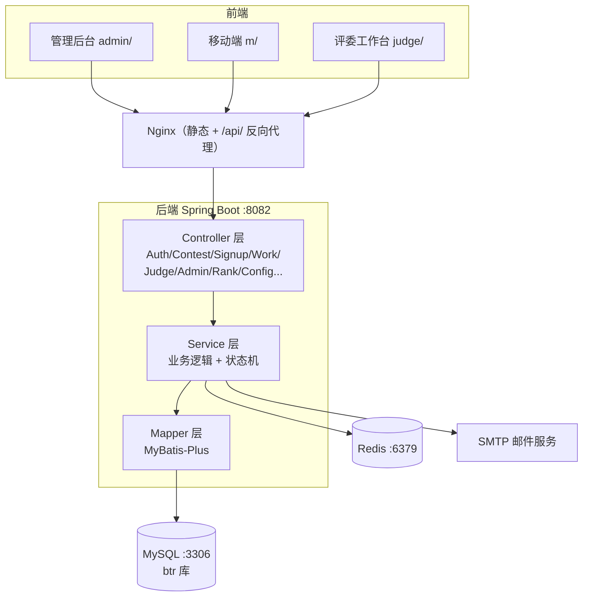
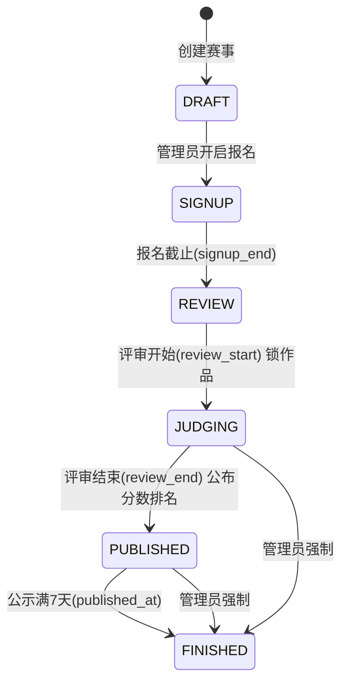

# BTR 赛事平台 · 开发文档

> 版本：v1.0.0 ｜ 最后更新：2026-11-05 ｜ 仓库：github.com/VOID12235/BRT

---

## 1. 项目概述

BTR 赛事平台（btr-platform）是一个面向高校/社区的线上赛事全流程管理系统，覆盖**赛事创建 → 报名 → 作品提交 → 评委打分 → 成绩公示 → 颁奖**的完整生命周期，同时提供管理后台、移动端、评委工作台三套前端界面。

### 1.1 核心能力

| 模块 | 能力 |
|---|---|
| 赛事管理 | 赛事创建/编辑/删除、状态机自动推进、赛题附件、奖项配置 |
| 报名系统 | 在线报名、报名审核、参赛信息管理 |
| 作品系统 | 在线提交/修改作品、作品锁定、打分中作品可见性控制 |
| 评委系统 | 评委分配（整体/按作品）、多评委打分、成绩聚合、管理员改分 |
| 榜单公示 | 成绩排名、获奖名单、公示期（7 天自动结束） |
| 用户体系 | 注册/登录、JWT、图形验证码、邮箱验证码、找回密码、角色权限 |
| 内容管理 | 公告（富文本）、邮件记录、系统日志 |
| 配置中心 | 站点信息、邮件、数据库、开关、上传限制、安全策略、模板 |

### 1.2 角色

| 角色 | 说明 | 权限范围 |
|---|---|---|
| PLAYER（选手） | 普通参赛用户 | 报名、提交/修改作品、查看榜单、个人中心 |
| JUDGE（评委） | 评审人员 | 仅打分中及以后阶段查看作品、打分、写评语 |
| ADMIN（管理员） | 平台运营 | 全部管理功能，可强制变更赛事状态、改分、固化结果 |

---

## 2. 技术栈

| 层 | 技术 | 版本/说明 |
|---|---|---|
| 语言 | Java | 21 |
| 框架 | Spring Boot | 4.1.2 |
| ORM | MyBatis-Plus | spring-boot4-starter + jsqlparser |
| 安全 | Spring Security + JJWT | JWT 访问令牌 2h / 刷新 7d |
| 数据库 | MySQL 8（生产）/ H2（测试） | utf8mb4 |
| 缓存 | Redis | 验证码、限流 |
| 邮件 | Spring Mail | SMTP SSL（163 等） |
| 构建 | Maven | package → fat jar |
| 前端 | 原生 HTML/CSS/JS | 无构建工具，静态部署 |
| 部署 | Nginx + systemd | CentOS / Ubuntu |

前端开源组件：ECharts（图表）、wangEditor（富文本）、qrcodejs（二维码）、Cropper（头像裁剪）、docx-preview / jszip / xlsx.full.min（文档在线预览）、DPlayer（视频播放）。

---

## 3. 系统架构

### 3.1 分层架构



### 3.2 部署拓扑（生产）

```
公网 103.236.92.193:20757
        │
        ▼
Nginx（/etc/nginx/sites-available/btr + btr-20757）
├── 静态资源 → /var/www/btr（admin/ m/ judge/ assets/）
└── /api/     → proxy_pass http://127.0.0.1:8082
        │
        ▼
btr.service（systemd）
└── java -jar /root/BRT/target/btr-platform.jar
    ├── MySQL 127.0.0.1:3306 / btr
    └── Redis 127.0.0.1:6379
```

Nginx 监听端口：`20757`（主访问入口）、`8080`、`8081`、`80`、`443`。后端仅监听 `127.0.0.1:8082`，不直接暴露公网。

---

## 4. 项目结构

### 4.1 后端（src/main/java/com/btr/platform）

```
├── BtrApplication.java        启动类
├── common/                    通用组件（ApiResponse/BizException/PageResult/
│                             CacheService/RateLimitService/ClientIpResolver）
├── config/                    SecurityConfig/MybatisConfig/WebConfig/AsyncConfig
├── controller/                接口层（14 个控制器）
├── dto/                       Requests.java / Views.java（请求与视图对象）
├── entity/                    实体（15 个，映射数据表）
├── mapper/                    MyBatis-Plus Mapper（15 个）
├── security/                  JwtService/JwtAuthFilter/SecurityUtils/UserPrincipal
└── service/                   业务层（19 个 Service + 状态机调度器）
```

### 4.2 前端（frontend/）

```
├── admin/         管理后台（14 页：赛事/报名/作品/评委/榜单/用户/公告/
│                 奖项/邮件/日志/设置/统计/导出/仪表盘）
├── m/             移动端（14 页：首页/赛事列表/赛事详情/报名/提交作品/
│                 榜单/个人中心/登录/公告/评委工作台/下载App/关于...）
├── judge/         评委工作台（评委首页/打分页）
├── assets/        静态资源（css/ js/ vendor/ 第三方库）
├── common/        公共 header/footer
└── *.html         桌面端页面（index/contest-list/contest-detail/rank...）
```

### 4.3 部署脚本（deploy-scripts/）

| 脚本 | 用途 |
|---|---|
| btr-deploy-admin.py | 部署管理后台（admin.js + 全部 admin HTML） |
| btr-deploy-buttons.py | 部署移动端 + 开源库 + rank.html |
| btr-deploy-status.py | 部署 api.js + 样式（base/components/m.css） |
| btr-judge-deploy.py | 后端部署：SFTP 源码 → mvn package → systemctl restart → health |
| btr-admin-bump.py | 管理端 JS 版本号升级 |
| btr-restart.py | 重启 btr.service 并验证 health |
| btr-captcha-toggle.py | 验证码开关切换 |
| btr-nginx-20757.py | Nginx 20757 监听配置（故障恢复） |
| btr-*.sql / *-migrate.py | 数据迁移脚本 |
| btr-*-diag.py | 服务器/nginx/网络/防火墙诊断脚本族 |

---

## 5. 核心业务模型：赛事状态机

赛事状态是全部业务规则的核心，由 `ContestStatusScheduler` 每 60 秒自动巡检推进，管理员可手动强制变更（`POST /api/v1/contests/{id}/status`）。



### 5.1 状态定义与阶段规则

| 状态 | 文案 | 报名 | 提交/修改作品 | 作品可见性 | 分数排名 |
|---|---|---|---|---|---|
| DRAFT | 筹备中 | ✗ | ✗ | — | — |
| SIGNUP | 报名中 | ✔ | ✗（进行中才开放） | 公众不可见 | — |
| REVIEW | 进行中 | ✗ | ✔（可修改） | 作品可看（公开赛） | 不公布 |
| JUDGING | 打分中 | ✗ | ✗（作品锁定 locked=1） | 仅评委/管理员可见 | 不公布 |
| PUBLISHED | 已公示 | ✗ | ✗（锁定） | 全部公开 | ✔ 公布 |
| FINISHED | 已结束 | ✗ | ✗（锁定） | 全部公开 | ✔ 公布 |

### 5.2 自动推进逻辑（ContestStatusScheduler）

| 迁移 | 触发字段 | 附加动作 |
|---|---|---|
| SIGNUP → REVIEW | `signup_end <= now` | — |
| REVIEW → JUDGING | `review_start <= now` | 线上赛作品全部 `locked=1` |
| JUDGING → PUBLISHED | `review_end <= now` | 记录 `published_at`（无则取当前） |
| PUBLISHED → FINISHED | `published_at + 7天 <= now` | — |

未配置对应时间字段的赛事不会自动推进，由管理员手动变更。

### 5.3 作品锁定

- 打分中（JUDGING）及之后阶段，线上赛作品 `locked=1`，选手端不再提供"修改作品"入口，后端 `PUT /works` 校验状态集合 `SIGNUP/REVIEW`。
- 打分中榜单/作品 tab 只展示作品与状态，不展示分数与排名。
- 已公示/已结束：公布本赛程所有作品与最终结果。

---

## 6. 数据库设计

库名：`btr`（MySQL 8，utf8mb4_unicode_ci）。基础结构见 `src/main/resources/schema-mysql.sql`，评审/打分中/赛题字段由迁移脚本追加。

### 6.1 表清单

| 表 | 说明 |
|---|---|
| sys_user | 用户（含评委/管理员） |
| contest | 赛事（含状态机、评审参数、赛题） |
| contest_signup | 报名记录 |
| contest_work | 参赛作品 |
| contest_judge_assign | 评委分配 |
| contest_score | 评委打分（含管理员改分） |
| contest_award | 奖项配置 |
| contest_winner | 获奖名单（固化结果） |
| notice / notice_read | 公告与已读 |
| upload_file | 上传文件（md5 去重） |
| sys_email_record | 邮件发送记录 |
| sys_config | 键值配置中心 |
| sys_log | 操作日志 |

### 6.2 核心表结构

**sys_user**

| 字段 | 类型 | 说明 |
|---|---|---|
| id | BIGINT PK | |
| account | VARCHAR(64) UNIQUE | 登录账号 |
| password | VARCHAR(100) | BCrypt 加密 |
| nickname | VARCHAR(64) | 昵称 |
| email | VARCHAR(128) UNIQUE | 邮箱（登录/找回） |
| phone | VARCHAR(32) | 手机 |
| role | VARCHAR(20) | PLAYER / JUDGE / ADMIN |
| status | VARCHAR(20) | ACTIVE / DISABLED |
| avatar | VARCHAR(255) | 头像 URL |
| token_version | INT | JWT 失效控制 |

**contest**（含迁移追加字段）

| 字段 | 类型 | 说明 |
|---|---|---|
| id | BIGINT PK | |
| title | VARCHAR(160) | 赛事标题 |
| cover / summary / description / rules | VARCHAR/TEXT | 宣传与规则 |
| prize_amount | DECIMAL(14,2) | 奖金总额 |
| mode | VARCHAR(10) | ONLINE / OFFLINE |
| signup_start / signup_end | DATETIME | 报名起止（→REVIEW） |
| review_start / review_end | DATETIME | 评审起止（→JUDGING / →PUBLISHED） |
| status | VARCHAR(20) | DRAFT/SIGNUP/REVIEW/JUDGING/PUBLISHED/FINISHED |
| is_public | BOOLEAN | 是否公开 |
| judge_per_work | INT | 每作品评委数（默认 3） |
| aggregate_mode | VARCHAR(10) | AVG（当前仅平均） |
| review_deadline | DATETIME | 评审截止提醒 |
| results_locked | TINYINT | 结果是否已固化 |
| finalized_at | DATETIME | 固化时间 |
| published_at | DATETIME | 公示开始时间（+7 天 → 已结束） |
| topic_file_name / topic_file_url | VARCHAR | 赛题附件（进行中阶段对选手展示） |

**contest_work**

| 字段 | 类型 | 说明 |
|---|---|---|
| id | BIGINT PK | |
| signup_id | BIGINT UNIQUE | 关联报名 |
| contest_id / user_id | BIGINT | 赛事/作者 |
| title / description | VARCHAR | 作品信息 |
| file_url / file_name | VARCHAR | 作品文件 |
| status | VARCHAR(20) | SUBMITTED / WITHDRAWN |
| locked | BOOLEAN | 打分中起锁定 |
| submitted_at / updated_at | DATETIME | 提交/更新时间 |

**contest_judge_assign**

| 字段 | 类型 | 说明 |
|---|---|---|
| id | BIGINT PK | |
| contest_id | BIGINT | |
| judge_id | BIGINT | 评委用户 ID |
| work_id / signup_id | BIGINT | 分配的作品/报名（NULL = 整体分配） |
| assign_type | VARCHAR(10) | ALL=整体动态跟随 / ITEM=指定作品 |

**contest_score**

| 字段 | 类型 | 说明 |
|---|---|---|
| id | BIGINT PK | |
| contest_id / work_id / signup_id | BIGINT | |
| judge_id | BIGINT | 打分评委 |
| score | DECIMAL(5,2) | 原始分 |
| comment | VARCHAR(1000) | 评语 |
| adjusted_score | DECIMAL(5,1) | 管理员改分 |
| adjust_reason / adjust_by / adjusted_at | VARCHAR/BIGINT/DATETIME | 改分留痕 |

**contest_award / contest_winner**

| 表 | 字段要点 |
|---|---|
| contest_award | contest_id、name（一等奖/最佳创意...）、quota、prize_amount、gift、sort_order |
| contest_winner | contest_id、award_id、work_id、signup_id、rank_no、published |

---

## 7. 核心模块设计

### 7.1 认证与安全

- **注册**：邮箱验证码（`POST /auth/send-register-code` → `POST /auth/register`），图形验证码可开关（`switch.captcha_enabled`）。
- **登录**：账号/邮箱 + 密码 + 图形验证码 → 返回 `accessToken`（2h）与刷新令牌（7d）；`token_version` 变更可全局踢下线。
- **JWT 过滤**：`JwtAuthFilter` 解析 `Authorization: Bearer`，注入 `SecurityUtils.current()`。
- **授权**：`@PreAuthorize("hasRole('ADMIN')")` 等注解；评委/选手接口按角色校验。
- **防暴力**：`RateLimitService`（Redis 计数）+ 安全策略"错 5 次锁 10 分钟"（sys_config security.*）。
- **找回密码**：`/auth/forgot-password` 邮件验证码 → `/auth/reset-password`。

### 7.2 报名与作品

- 报名：`POST /signups`（赛事报名中，唯一约束 user_id+contest_id）；管理员审核 `PUT /admin/signups/{id}/status`。
- 作品提交：`POST /works`（需报名 APPROVED + 赛事进行中 REVIEW）；修改 `PUT /works/{id}` 限 SIGNUP/REVIEW 状态。
- 作品锁定：打分中起 `locked=1`，前端隐藏"修改作品"入口。
- 赛题附件：管理端配置 `topic_file_url/topic_file_name`，选手端提交页展示（在线预览/下载）。

### 7.3 评委分配与打分（满血版）

**分配（AdminController + JudgeService）**

| 方式 | 说明 |
|---|---|
| 整体分配（ALL） | 某评委负责整场赛事全部作品，动态跟随新提交作品 |
| 按作品分配（ITEM） | 评委 + 指定作品绑定，精确控制 |

- 一个项目可有多个评委；一个评委可分配多场赛事。
- 分配记录 `contest_judge_assign`（assign_type=ALL/ITEM）。

**打分（JudgeService）**

- `GET /judge/tasks?contestId=`：评委任务列表，**仅在 JUDGING/FINISHED/PUBLISHED 阶段可见**（报名中/进行中返回空）。
- `POST /judge/scores`：评委打分 + 评语，唯一约束（work_id, judge_id）。
- **成绩聚合**：`scoreResults()` 按 `aggregate_mode=AVG` 聚合各评委分 → 平均分排名；每次聚合后复核分差、重建排名（rank_no 连续、同分并列）。
- **管理员改分**：`PUT /admin/judge-assign/scores` 改 `adjusted_score`（留痕 adjust_by/reason/at），聚合改用调整分重算排名，改分自动联动榜单与获奖名单。
- **结果固化**：`POST /admin/judge-assign/finalize` → 写入 `contest_winner`（按奖项 quota 生成 rank_no）、置 `results_locked=1`、记录 `finalized_at`；固化的 winners 在已公示赛事榜单展示。

### 7.4 榜单与公示

- `GET /ranks?contestId=`：按赛事状态返回榜单数据（含 status/published/rows）。
- 打分中：只返回作品列表（无分数/排名），前端渲染作品卡片网格。
- 已公示/已结束：返回作品 + 平均分 + 排名 + 获奖名单（winners）。
- `GET /ranks/winners`：获奖名单公开接口。

### 7.5 配置中心（sys_config）

管理后台"系统设置"7 个 Tab 全部落地：

| Tab | 配置键前缀 | 说明 |
|---|---|---|
| 站点信息 | site.* | 站点名、页脚、关于文案 |
| 邮件服务 | mail.* | SMTP 主机/端口/账号/授权码/发件人（163 SSL 465），支持测试发送 |
| 数据库 | db.* | 生产库地址/库名/账号/密码，支持测试连接 |
| 开关 | switch.* | 注册开关、验证码开关 |
| 上传限制 | upload.* | 允许类型、最大 50MB |
| 安全策略 | security.* | 登录失败锁定阈值/时长 |
| 邮件模板 | template.* | 注册/找回密码等模板 |

### 7.6 在线预览（作品文件）

选手端/榜单/管理端的"在线预览"（非下载）：

| 类型 | 预览方式 |
|---|---|
| 图片（jpg/png/gif/webp...） | 弹窗内嵌 `` |
| PDF | 弹窗内嵌 `<iframe>`（浏览器原生渲染） |
| 文本（txt/md/log...） | fetch 后 `<pre>` 展示 |
| Word/Excel（docx/xlsx） | docx-preview + xlsx.full.min 前端渲染 |
| 视频（mp4...） | DPlayer 播放 |
| 不支持类型 | 弹窗提示"无法在线预览，请使用下载作品"，保留下载按钮 |

### 7.7 其他模块

- **公告**：wangEditor 富文本，置顶、已读记录（notice_read）。
- **奖项**：多奖项配置（quota/奖金/礼品/排序），固化时按奖项生成 winners。
- **导出**：`/admin/export/signups`、`/admin/export/winners`（CSV）。
- **统计**：`/admin/stats/contests`、仪表盘 dashboard（赛事数/报名数/作品数/待办）。
- **邮件**：异步发送（AsyncConfig），记录 sys_email_record（PENDING/SUCCESS/FAILED）。
- **日志**：操作日志 sys_log（user/action/target/ip），管理后台可查。

---

## 8. API 参考

统一前缀 `/api/v1`，返回 `{code, message, data}`（code=0 成功）。鉴权：`Authorization: Bearer <accessToken>`。

### 8.1 认证 /auth

| 方法 | 路径 | 说明 |
|---|---|---|
| POST | /auth/register | 注册 |
| POST | /auth/send-register-code | 注册邮箱验证码 |
| POST | /auth/login | 登录（图形验证码） |
| POST | /auth/refresh | 刷新令牌 |
| POST | /auth/logout | 登出 |
| GET | /auth/me | 当前用户 |
| PUT | /auth/me | 更新资料/头像 |
| GET | /auth/captcha | 图形验证码（key + base64 image） |
| POST | /auth/forgot-password | 发送找回密码邮件 |
| POST | /auth/reset-password | 重置密码 |

### 8.2 赛事 /contests

| 方法 | 路径 | 说明 |
|---|---|---|
| GET | /contests | 列表（all=true 含全部状态） |
| GET | /contests/{id} | 详情（含奖项/评审参数） |
| POST | /contests | 创建（ADMIN） |
| PUT | /contests/{id} | 更新（ADMIN，含赛题附件） |
| POST | /contests/{id}/status | 强制变更状态（ADMIN） |
| DELETE | /contests/{id} | 删除（ADMIN） |
| GET/POST/PUT/DELETE | /contests/{id}/awards... | 奖项管理 |

### 8.3 报名与作品 /signups /works

| 方法 | 路径 | 说明 |
|---|---|---|
| POST | /signups | 报名 |
| GET | /signups/mine | 我的报名 |
| DELETE | /signups/{id} | 取消报名 |
| POST | /works | 提交作品 |
| PUT | /works/{id} | 修改作品（SIGNUP/REVIEW） |
| DELETE | /works/{id} | 撤回作品 |
| GET | /works/mine | 我的作品 |
| GET | /works?contestId= | 作品列表（打分中仅评委/管理员可见） |
| GET | /users/{id}/portfolio | 用户作品集 |

### 8.4 评委 /judge

| 方法 | 路径 | 说明 |
|---|---|---|
| GET | /judge/tasks?contestId= | 我的评审任务（JUDGING+可见） |
| GET | /judge/contests | 我参与的赛事 |
| GET | /judge/projects | 我的项目 |
| GET | /judge/progress | 评审进度 |
| POST | /judge/scores | 打分+评语 |

### 8.5 管理 /admin（全部 ADMIN）

| 方法 | 路径 | 说明 |
|---|---|---|
| GET | /admin/dashboard | 仪表盘统计 |
| GET/PUT | /admin/signups、/admin/signups/{id}/status | 报名管理 |
| GET/PUT | /admin/works、/admin/works/{id}/lock | 作品管理/锁定 |
| GET | /admin/judges | 评委列表 |
| GET/POST/DELETE | /admin/judge-assign... | 评委分配 |
| GET/PUT | /admin/judge-assign/scores | 成绩视图/改分 |
| POST | /admin/judge-assign/finalize | 固化结果 |
| GET/PUT/POST | /admin/contests/{id}/ranking、/winners、/winners/recompute | 排名与获奖 |
| GET/PUT/POST/DELETE | /admin/users、/notices... | 用户/公告管理 |
| GET | /admin/stats/contests、/export/signups、/export/winners | 统计与导出 |
| GET/PUT/POST | /admin/config/{mail,site,switches,templates,uploads,security,db,redis} | 配置中心 |

### 8.6 其他

| 方法 | 路径 | 说明 |
|---|---|---|
| GET | /ranks?contestId= | 榜单（状态敏感） |
| GET | /ranks/winners | 获奖名单 |
| GET | /config/public-site | 公开站点配置 |
| GET | /health | 健康检查（status/db） |
| GET/POST | /files... | 文件上传/访问 |

---

## 9. 前端架构

### 9.1 路由映射

| 端 | 页面 | 说明 |
|---|---|---|
| 管理后台 /admin/ | admin-index（仪表盘）、contest-manage、signup-manage、work-manage、judge-manage、rank-manage、user-manage、notice-manage、award-manage、mails、logs、stats、export、settings | 14 页，`admin.js` 统管，侧边栏渐变+折叠、面包屑、仪表盘统计卡 |
| 移动端 /m/ | index、contests、contest、signup、work、rank、center、login、notices、judge、download、about... | `m.js` 统管，含在线预览弹窗 |
| 评委端 /judge/ | judge-index、judge-score | `judge.js` |
| 桌面端 / | index、contest-list、contest-detail、rank、signup、user-center... | 响应式 |

### 9.2 关键 JS 模块

| 文件 | 职责 |
|---|---|
| assets/js/api.js | API 封装（fetch + Bearer）、状态映射 STATUS（含 JUDGING"打分中"） |
| assets/js/admin.js | 管理后台逻辑 + 状态徽章 + 成绩排名视图 |
| assets/js/common.js | 公共组件（验证码、分页、状态徽章） |
| m/m.js | 移动端逻辑 + 在线预览（previewWork 图片/PDF/文本弹窗） |
| assets/js/rank.js | 榜单渲染（JUDGING 作品卡片网格/预览/下载） |
| assets/js/judge.js | 评委工作台（任务/打分） |
| assets/js/work-submit.js | 作品提交（赛题卡展示） |

### 9.3 版本管理

前端静态资源通过 `?v=20261105xx` 版本号控制缓存，部署时统一 bump（btr-admin-bump.py 等）。

---

## 10. 部署指南

### 10.1 生产环境组件

| 组件 | 位置/端口 |
|---|---|
| 应用 jar | /root/BRT/target/btr-platform.jar |
| systemd | btr.service（运行 java -jar，端口 8082） |
| 前端 | /var/www/btr（nginx root） |
| MySQL | 127.0.0.1:3306，库 btr，用户 btr |
| Redis | 127.0.0.1:6379 |
| Nginx | 20757/8080/8081/80/443 |

### 10.2 首次部署

```bash
# 1) 初始化数据库
mysql -uroot -p < src/main/resources/schema-mysql.sql
mysql -uroot -p btr < deploy-scripts/btr-judge-migrate.sql
mysql -uroot -p btr < deploy-scripts/btr-judging-migrate.sql
mysql -uroot -p btr < deploy-scripts/btr-topic-migrate.sql

# 2) 构建
mvn -DskipTests package

# 3) systemd 服务（/etc/systemd/system/btr.service）
[Unit]
Description=BTR Competition Platform
After=mysql.service redis-server.service
[Service]
WorkingDirectory=/root/BRT
ExecStart=/usr/bin/java -jar /root/BRT/target/btr-platform.jar
Restart=always
Environment=SPRING_PROFILES_ACTIVE=prod SERVER_PORT=8082
[Install]
WantedBy=multi-user.target

systemctl daemon-reload && systemctl enable --now btr.service

# 4) 前端 + Nginx 配置（sites-available/btr + btr-20757）→ nginx -t && systemctl reload nginx

# 5) 验证
curl -s http://127.0.0.1:8082/api/v1/health   # {"code":0,...,"status":"UP"}
```

### 10.3 迭代部署流程

| 改动 | 流程 |
|---|---|
| 后端 Java | 本地改 → `btr-judge-deploy.py`（SFTP 源码 → mvn package → restart → health） |
| 管理后台 | bump 版本 → `btr-deploy-admin.py` |
| 移动端/榜单 | bump 版本 → `btr-deploy-buttons.py` |
| api.js / 样式 | bump 版本 → `btr-deploy-status.py` |

铁律：后端重启必须走 `systemctl restart btr.service`，禁止手动 nohup 抢占 8082。

### 10.4 环境变量

| 变量 | 默认 | 说明 |
|---|---|---|
| SPRING_PROFILES_ACTIVE | dev | prod 用生产配置 |
| SERVER_PORT | 8080 | 生产 8082 |
| JWT_SECRET | dev 值 | 生产必须修改 |
| CAPTCHA_ENABLED | false | 生产 true |
| UPLOAD_DIR | ./uploads | 上传目录 |
| TRUST_PROXY | false | Nginx 后置 true |

---

## 11. 运维要点

- **健康检查**：`curl http://127.0.0.1:8082/api/v1/health`（code=0 且 data.status=UP/db=UP）。
- **日志**：`journalctl -u btr.service --no-pager -n 50`；Nginx：`/var/log/nginx/access.log`、`error.log`。
- **状态机**：定时器每 60s 巡检（initialDelay 30s）；日志输出"赛事状态自动推进：... → ..."。
- **验证码**：生产 `switch.captcha_enabled=true`；验证码每次获取即失效（Redis 一次性 key）。
- **故障恢复**：20757 无监听时执行 `btr-nginx-20757.py`；后端异常重启走 `btr-restart.py`。
- **数据备份**：MySQL `mysqldump btr`；上传目录 `./uploads` 需同步备份。

---

## 12. 安全设计

| 项 | 措施 |
|---|---|
| 密码 | BCrypt 存储，无明文 |
| 令牌 | JWT（HS256），2h 访问 + 7d 刷新，token_version 可吊销 |
| 验证码 | 图形验证码（生产开启）+ 邮箱验证码（注册/找回） |
| 限流 | Redis 计数限流 + 登录失败锁定 |
| 越权 | Controller 层 @PreAuthorize 角色校验；作品接口校验归属 |
| 作品可见性 | 打分中仅评委/管理员（后端 WorkService.publicList 特权判断），避免评审阶段泄露 |
| 上传安全 | 类型白名单（upload.allowed_types）+ 50MB 限制 + md5 去重 |
| 注入 | MyBatis-Plus 参数化；Nginx 代理头正确传递 |

---

## 13. 版本记录

| 提交 | 内容 |
|---|---|
| 5378647 | 开源组件集成（wangEditor/qrcodejs/Cropper 等） |
| 502eec5 | 评委分配满血版 P0（多评委/整体与按作品/聚合/改分/固化） |
| 717a02a | 打分中（JUDGING）状态机满血版 + 在线预览弹窗 + 评委可见性 |
| 0ba1a41 | 管理后台控制面板重构优化 |
| 4310144 | 赛题配置 + 作品可见性优化（管理员/评委可见打分中作品） |
| f3bf432 | 运维修复：Nginx 20757 监听 + 诊断脚本族 |

---

*本文档基于当前代码与生产部署状态整理，数据库结构以 `schema-mysql.sql` + 迁移脚本为准。*
